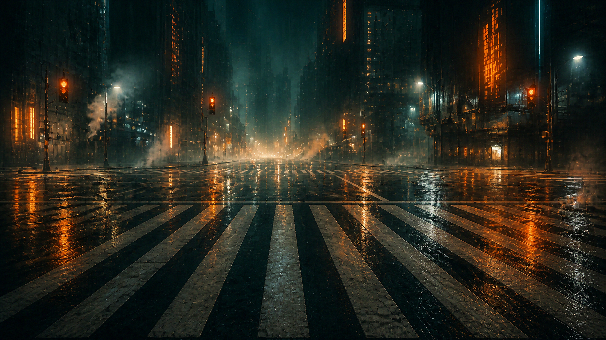

# 2049 — an Omarchy theme

A cinematic cyberpunk theme for [Omarchy](https://omarchy.org): deep teal-black
nights cut by one strike of burnt orange. Inspired by the color language of a
certain 2017 neo-noir film — cold rain-soaked streets, warm neon, and fog.



## Install

```bash
omarchy theme install https://github.com/eliasstravik/omarchy-2049-theme
```

Or via the Omarchy menu: `Super + Alt + Space` → Install → Style → Theme, and
paste this repo's URL.

## Palette

| Role | Hex |
|---|---|
| Background | `#0d161c` |
| Foreground | `#d8cbb0` |
| Accent | `#f78b04` |
| Selection | `#14333a` |
| Bright foreground | `#ffe5b4` |

Full palette in [`colors.toml`](colors.toml). Every app config (terminal,
Hyprland, btop, editors, …) is generated from it by Omarchy's theme templates.

## Wallpaper

The bundled wallpaper is AI-generated (an original composition, not derived
from any film still) and is released to the public domain under
[CC0](https://creativecommons.org/publicdomain/zero/1.0/). Use it however you
like.

## License

Theme files are MIT licensed (see [LICENSE](LICENSE)). The wallpaper is CC0 as
noted above.
